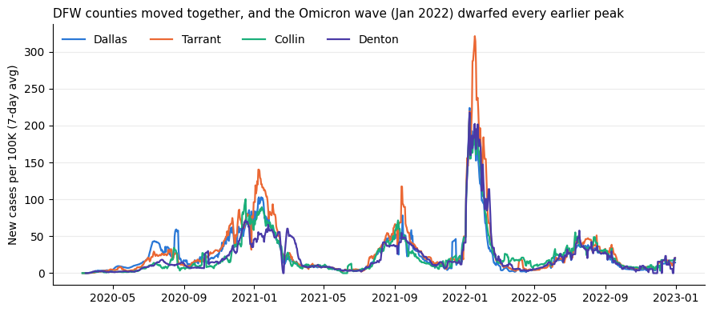

# Texas COVID-19 Trends with SQL Window Functions

County-level analysis of COVID-19 cases and deaths across Texas (Feb 2020 – Dec 2022) using **DuckDB SQL** window functions, run from Python in Google Colab.

**Notebook:** [`texas_covid_window_functions.ipynb`](texas_covid_window_functions.ipynb)

## What it does
- Reads the New York Times county-level COVID data straight from the web (DuckDB `httpfs`) and filters to Texas: **252,446 rows across 255 counties**.
- Focuses on the **ten most populous Texas counties**, joining 2020 Census populations to put each on a per-100K basis, with a closer look at Dallas–Fort Worth.
- Turns cumulative totals into daily new cases with `LAG`, then smooths them with a **7-day rolling average** (`AVG ... OVER (ROWS BETWEEN 6 PRECEDING AND CURRENT ROW)`).
- Finds each county's peak day with `ROW_NUMBER`, builds a monthly pivot with `SUM(CASE ...)`, and compares deaths per 100 cases by year.

## SQL skills shown
Window functions (`LAG`, `ROW_NUMBER`, rolling `AVG ... OVER`) · `PARTITION BY` · CTEs · joins · `SUM(CASE ...)` pivots · date functions · reading remote CSVs with DuckDB

## Key findings
- **One statewide peak:** all ten of the largest counties peaked between **January 9 and 25, 2022** (the Omicron wave).
- **Peak intensity (7-day avg per 100K):** Harris 411 · Tarrant 321 · Dallas 224 · Denton 218 · Collin 212.
- **DFW, Omicron vs. the prior winter:** 360,196 cases in Jan 2022 vs. 170,759 in Jan 2021, more than double.
- **Deaths per 100 cases fell sharply:** El Paso dropped from 2.14 to 0.71 and Hidalgo from 1.90 to 0.37 from 2020 to 2022.

## How to run
Open the notebook in Google Colab and choose **Runtime → Run all**. Data is read directly from the NYT public repository.

## Tools
Python · DuckDB · pandas · matplotlib · Google Colab

**Data:** The New York Times, *Coronavirus (Covid-19) Data in the United States*; U.S. Census Bureau 2020 population counts.
